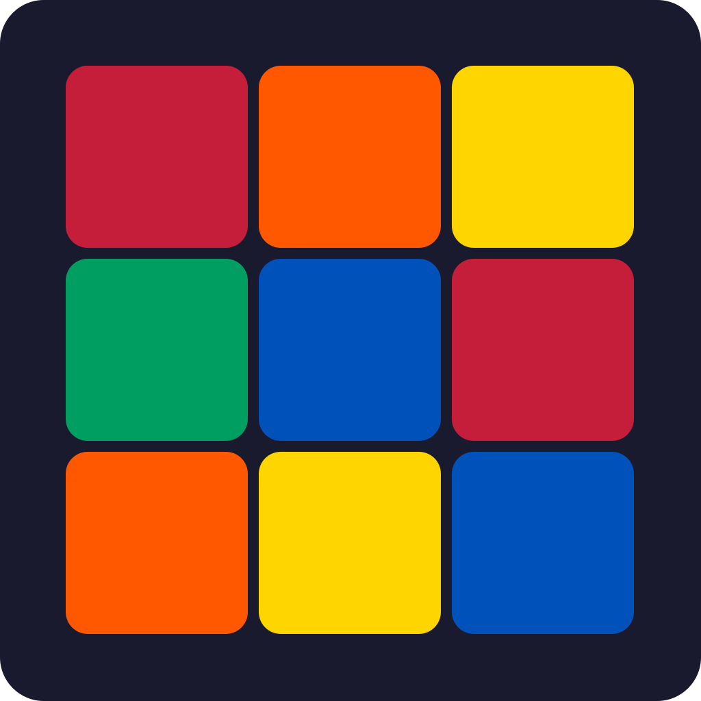

# Rubik's Tracker

A personal Rubik's cube solve tracker built with Electron, React, and TypeScript.



## Features

- ⏱️ **Timer** — track solve times with inspection countdown (WCA rules)
- 🧩 **Multi-cube support** — 2x2 through 7x7
- 📊 **Statistics** — Ao5, Ao12, Ao100, Mo3, best/worst, standard deviation
- 🏆 **Leaderboards** — personal bests across sessions
- 🔀 **Scramble visualization** — interactive 3D scrambles via `cubing.js`
- 💾 **Local storage** — SQLite database, your data stays on your machine

## Screenshots

<!-- TODO: Add screenshots of the timer, stats, and leaderboard pages -->

## Getting Started

Requires Node.js 22.12+ and [pnpm](https://pnpm.io) (`corepack enable` picks up the pinned version).

```bash
# Install dependencies
pnpm install

# Run in development mode
pnpm dev

# Typecheck and run tests
pnpm typecheck
pnpm test

# Build installers
pnpm build && pnpm build:win    # Windows (NSIS)
pnpm build && pnpm build:linux  # Linux (AppImage)
pnpm build && pnpm build:mac    # macOS (DMG for Apple Silicon and Intel; run on a Mac)
```

Packaging is configured in [`electron-builder.ts`](electron-builder.ts).

### Releasing

Every merge into `master` builds the Windows, Linux and macOS installers. To publish a release,
bump `version` in `package.json` and add a matching `## [x.y.z] - date` section to
[`CHANGELOG.md`](CHANGELOG.md) in the same pull request. When that version has no tag yet, the
merge tags it and publishes a GitHub release with the installers and that CHANGELOG section as
its notes. Merges that don't bump the version only build. Pull requests show which version a
merge would publish, and fail early if its CHANGELOG section is missing.

### Windows code signing

Release builds are signed with [Azure Artifact Signing](https://learn.microsoft.com/azure/artifact-signing/)
when it is configured; otherwise installers are built unsigned. To enable it, add these to the
repository settings (**Settings → Secrets and variables → Actions**):

| Name | Kind | Value |
|------|------|-------|
| `AZURE_SIGNING_ENDPOINT` | Variable | Account endpoint, e.g. `https://eus.codesigning.azure.net` |
| `AZURE_SIGNING_ACCOUNT` | Variable | Signing account name |
| `AZURE_SIGNING_CERT_PROFILE` | Variable | Certificate profile name |
| `AZURE_SIGNING_PUBLISHER` | Variable | Publisher name exactly as on the certificate |
| `AZURE_TENANT_ID` | Secret | Tenant of the app registration |
| `AZURE_CLIENT_ID` | Secret | App registration (client) ID |
| `AZURE_CLIENT_SECRET` | Secret | App registration client secret |

The app registration needs the *Artifact Signing Certificate Profile Signer* role on the
certificate profile. The same environment variables work for local signed builds.

### macOS code signing and notarization

Without a certificate, macOS builds are ad-hoc signed: they run, but Gatekeeper blocks the first
launch of a downloaded copy (see [Download](#download)). To ship signed, notarized DMGs, add:

| Name | Kind | Value |
|------|------|-------|
| `MAC_CERTIFICATE` | Secret | Base64 of the *Developer ID Application* certificate exported as `.p12` |
| `MAC_CERTIFICATE_PASSWORD` | Secret | Password of that `.p12` |
| `APPLE_ID` | Secret | Apple ID of the developer account |
| `APPLE_APP_SPECIFIC_PASSWORD` | Secret | [App-specific password](https://support.apple.com/102654) for that Apple ID |
| `APPLE_TEAM_ID` | Variable | Developer team ID |

Locally, set `CSC_LINK` (path or base64 of the `.p12`), `CSC_KEY_PASSWORD` and the three `APPLE_*`
variables instead.

## Download

Grab the latest installer from the [Releases](https://github.com/cyberced21/rubiks-tracker/releases) page:

- **Windows:** `rubiks-tracker-<version>-win-x64.exe`
- **Linux:** `rubiks-tracker-<version>-linux-x86_64.AppImage` (`chmod +x` it, then run)
- **macOS:** `rubiks-tracker-<version>-mac-arm64.dmg` for Apple Silicon, `-mac-x64.dmg` for Intel.
  Until the DMGs are signed, macOS reports the app as damaged or from an unidentified developer on
  first launch; after dragging it to Applications, run
  `xattr -dr com.apple.quarantine "/Applications/Rubiks Tracker.app"` once.

## Tech Stack

| Layer | Technology |
|-------|-----------|
| Shell | Electron + electron-vite |
| UI | React 19 + TypeScript |
| Database | better-sqlite3 |
| Icons | Lucide React |
| Testing | Vitest |

## License

[MIT](LICENSE)
