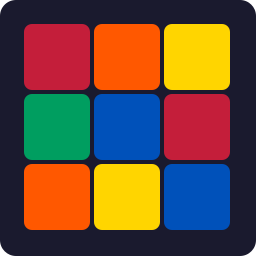

# Rubik's Tracker

A personal Rubik's cube solve tracker built with Electron, React, and TypeScript.



## Features

- ⏱️ **Timer** — track solve times with inspection countdown (WCA rules)
- 🧩 **Multi-cube support** — 2x2 through 7x7
- 📊 **Statistics** — Ao5, Ao12, Ao100, Mo3, best/worst, standard deviation
- 🏆 **Leaderboards** — personal bests across sessions
- 🔀 **Scramble visualization** — interactive 3D scrambles via `cubing.js`
- 💾 **Local storage** — SQLite database, your data stays on your machine

## Screenshots

<!-- TODO: Add screenshots of the timer, stats, and leaderboard pages -->

## Getting Started

Requires Node.js 22.12+ and [pnpm](https://pnpm.io) (`corepack enable` picks up the pinned version).

```bash
# Install dependencies
pnpm install

# Run in development mode
pnpm dev

# Typecheck and run tests
pnpm typecheck
pnpm test

# Build installers
pnpm build && pnpm build:win    # Windows (NSIS)
pnpm build && pnpm build:linux  # Linux (AppImage)
```

Packaging is configured in [`electron-builder.ts`](electron-builder.ts).

### Windows code signing

Release builds are signed with [Azure Artifact Signing](https://learn.microsoft.com/azure/artifact-signing/)
when it is configured; otherwise installers are built unsigned. To enable it, add these to the
repository settings (**Settings → Secrets and variables → Actions**):

| Name | Kind | Value |
|------|------|-------|
| `AZURE_SIGNING_ENDPOINT` | Variable | Account endpoint, e.g. `https://eus.codesigning.azure.net` |
| `AZURE_SIGNING_ACCOUNT` | Variable | Signing account name |
| `AZURE_SIGNING_CERT_PROFILE` | Variable | Certificate profile name |
| `AZURE_SIGNING_PUBLISHER` | Variable | Publisher name exactly as on the certificate |
| `AZURE_TENANT_ID` | Secret | Tenant of the app registration |
| `AZURE_CLIENT_ID` | Secret | App registration (client) ID |
| `AZURE_CLIENT_SECRET` | Secret | App registration client secret |

The app registration needs the *Artifact Signing Certificate Profile Signer* role on the
certificate profile. The same environment variables work for local signed builds.

## Download

Grab the latest installer from the [Releases](https://github.com/cyberced21/rubiks-tracker/releases) page.

## Tech Stack

| Layer | Technology |
|-------|-----------|
| Shell | Electron + electron-vite |
| UI | React 19 + TypeScript |
| Database | better-sqlite3 |
| Icons | Lucide React |
| Testing | Vitest |

## License

[MIT](LICENSE)
